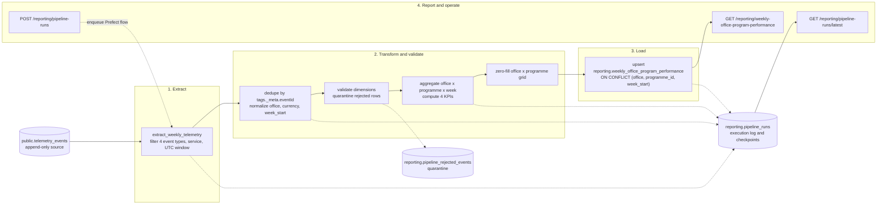

# Nexova Business Performance Data Pipeline — Design

**Working title:** `performance-ETL-design.md`
**Status:** Sprint 1 implemented on 2026-10-27 (`pipeline.py`, reporting schema/API, worker deployment). See section 22 for the delivered decisions and evidence pointers.
**Date:** 2026-10-26
**Owner:** Nexova AI Engineering team
**Audience:** Engineering, Laura Mendoza (CEO), Elena Vargas (L&D)
**Related documents:** [`ETL-company-Briefing.md`](./ETL-company-Briefing.md), [`ETL-plan-context.md`](./ETL-plan-context.md), [`nexova-telemetry-briefing.md`](../../docs/telemetry/nexova-telemetry-briefing.md), [`telemetry-plan.md`](../../docs/telemetry/telemetry-plan.md), [`event-schemas.json`](../../docs/telemetry/event-schemas.json)

> **Reading guide.** Section 1 states the purpose in one sentence. Section 7 defines the four KPI calculations. Sections 9 and 10 cover idempotency, recovery, and the execution log. Section 20 maps every milestone evaluation criterion to the section that satisfies it.

---

## 1. Purpose

**This pipeline produces the weekly, per-office, per-programme rollup that feeds Laura Mendoza's (CEO) and Elena Vargas's (L&D) Monday-morning "Weekly Office & Programme Performance Report", computing Material Cost per Office/Programme, Kits Delivered, Shortage Frequency, and Cost Variance Frequency from the four mandatory inventory events stored in `public.telemetry_events`.**

The report is for Laura (CEO) and Elena (L&D). It is not a technical report. It answers four business questions:

1. How much did each office spend on training and onboarding material for each programme this week?
2. How many kits or certificates actually reached clients, candidates, consultants, or agents?
3. How often did a programme's material stock fall below its configured minimum?
4. How often did a supplier's material cost move abnormally against its historical price?

The cadence is weekly. The report must be fresh by Monday morning. The grain is one row per `office`, `programme_id`, and ISO week (`week_start`, the Monday of the week in UTC).

---

## 2. Current State

### 2.1 What already exists

Nexova already captures telemetry for the inventory system. The capture path is documented in `docs/telemetry/telemetry-plan.md` and implemented in `backrooms/services/telemetry/` and `backrooms/services/Inventory-API/`.

| Area | Current state |
| --- | --- |
| Event catalogue | 22 event types, including the five mandatory inventory events from the telemetry briefing. |
| Ingestion | `POST /telemetry/events` accepts a `{ "events": [...] }` envelope, validates each event against the static catalogue, and persists valid siblings in one bulk insert. |
| Source table | `public.telemetry_events` in Supabase PostgreSQL. Columns: `id`, `timestamp`, `service`, `event_type`, `level`, `value`, `message`, `tags` (JSONB). |
| Business properties | Stored flat inside `tags`: `office`, `product_id`, `product_category`, `programme_id`, `quantity`, `currency`, and event-specific fields such as `unit_cost`, `supplier`, `min_stock`, and `variance_percent`. |
| Correlation metadata | Reserved under `tags._meta`: `eventId`, `sessionId`, `userId`, `schemaVersion`, `requestId`. |
| Duplicate delivery | Accepted by design. Retries and Beacon can produce multiple rows with the same `eventId`; the ingest layer does not claim exactly-once storage. |
| Technical report | `GET /telemetry/report` and `backrooms/services/telemetry/analysis.py` use Pandas to produce `events_per_day`, `error_rate_by_type`, and `page_load_latency_by_day`. The endpoint is read-only, cached for 60 seconds, and must not be changed by this pipeline. |
| Live data | The Sprint 2 live check recorded 35 `inbound_order_created`, 19 `outbound_order_created`, 3 `stock_threshold_triggered`, and 1 `kit_cost_variance_detected` from the working inventory flows; the Sprint 3 live check on 2026-10-23 recorded 64 rows in total. The table continues to grow as the backoffice is used. |

The four events this pipeline needs are therefore already being emitted with the required dimensions. The `inbound_order_created` payload already carries `quantity` and `unit_cost`, so no new event type or payload field is required for v1. The `unit_cost` field is the cost value the data-pipelines briefing anticipated.

### 2.2 The gap

The technical report answers engineering questions: how many events were captured, what share were errors, and how slow were page loads. It does not answer any of Laura's or Elena's questions:

- It does not aggregate by `office`, `programme_id`, and ISO week.
- It does not compute material cost from `quantity * unit_cost`.
- It does not count delivery, shortage, or cost-variance events as business KPIs.
- It does not write a business-facing reporting table.
- It does not leave an auditable record of extraction, transformation, and load runs.
- It has no idempotent load strategy for a business aggregate, because it does not load one.

There is also no `reporting` schema and no `services/reporting/` module in the repository today. The design in this document fills that gap without changing the technical report path.

### 2.3 What must not change

- `backrooms/services/telemetry/analysis.py` and `GET /telemetry/report` stay as they are.
- `public.telemetry_events` remains the source. It is never this pipeline's destination.
- No event outside the four listed in the data-pipelines briefing is required for v1.
- No currency conversion happens in this pipeline.

---

## 3. Scope and Non-Goals

### 3.1 In scope for v1

- The four KPIs defined in `ETL-company-Briefing.md` section 2.
- The exact destination table `reporting.weekly_office_program_performance`.
- A dedicated `reporting` schema and a new `backrooms/services/reporting/` module, which is the monorepo implementation of the milestone's logical `services/reporting/`.
- A Prefect design: one main flow, at least three tasks, states, blocks, retries, and a weekly schedule.
- Extraction, deduplication, transformation, zero-fill, currency enforcement, and idempotent upsert.
- A `reporting.pipeline_runs` execution log with checkpoint and recovery fields.
- A quarantine table for rejected events.
- Three business-facing endpoints: KPI query, latest run status, and manual trigger.
- Backfill and late-event recompute design.
- Observability, alerting, and reconciliation rules.

### 3.2 Out of scope for v1

- Implementation code, migrations, Prefect deployments, and tests. This milestone is design only.
- A dashboard. Part 3 will build the business dashboard that consumes the KPI endpoint.
- Real-time or streaming aggregation. The business deliverable is weekly.
- Currency conversion or FX rates. Each row stays in the office's local currency.
- New telemetry event types. The existing `inbound_order_created` cost fields are sufficient.
- The `direct_stock_edit_rejected` and `outbound_order_rejected` events as KPIs. They are captured by telemetry, but they are not among the four numbers in Laura's report. `direct_stock_edit_rejected` remains a governance signal for Patricia; `outbound_order_rejected` remains a demand-versus-stock signal for Elena. Neither is added to this pipeline's destination.
- Candidate, client, consultant, or agent personal data. The source events do not contain it, and the pipeline does not read `message`, `tags._meta.userId`, or `assigned_to`.
- Historical weeks before the first complete ISO week with source data. Backfill can cover them once telemetry exists.

---

## 4. Business Deliverable and KPI Contract

### 4.1 Deliverable

A weekly report that Laura can open on Monday morning without calling Elena or Patricia. It compares Valencia and Miami side by side on material investment and delivery for each programme. Elena uses the same numbers to decide when to reprint or reorder before a large enrolment wave. The report is driven by the four mandatory telemetry events, not by a manual spreadsheet.

### 4.2 KPI definitions

| KPI | Destination field | Source event | Calculation | Business note |
| --- | --- | --- | --- | --- |
| Material Cost per Office/Programme | `total_material_cost` | `inbound_order_created` | Sum of `quantity * unit_cost` over deduplicated inbound events for the week. Use decimal arithmetic, round to 0.01. | The amount stays in the office's local currency. `unit_cost` is per unit; multiplying by `quantity` gives the batch cost. The event's `value` column is not used for cost. |
| Kits Delivered | `kits_delivered_count` | `outbound_order_created` | Count of deduplicated outbound events for the week. | This is a count of delivery events, not a sum of `quantity`. The briefing asks how many kits or certificates were delivered; each event represents one delivery. |
| Shortage Frequency | `shortage_events_count` | `stock_threshold_triggered` | Count of deduplicated threshold events for the week. | The event is edge-triggered when stock crosses below `min_stock`, and the emitter throttles it to at most one per product per 60 minutes. The KPI therefore counts captured shortage triggers, not every minute a product is below threshold. This is stated in the report metadata and in section 19. |
| Cost Variance Frequency | `cost_variance_events_count` | `kit_cost_variance_detected` | Count of deduplicated variance events for the week. | The emitter fires only when the absolute variance exceeds 10 percent and throttles to one per `(product_id, supplier)` per 24 hours. The KPI counts captured price-variance alerts, not every price change. This is stated in the report metadata and in section 19. |
| Currency | `currency` | Event `currency` | `EUR` for `valencia`, `USD` for `miami`. | Never convert or mix currencies. A row with a mismatched currency is rejected, not summed. |
| Week | `week_start` | Event `timestamp` | Monday of the ISO week in UTC. | Only complete weeks are published. A partial current week is never written to the report. |

> **Open confirmation for Part 2:** the briefing defines `kits_delivered_count` as a count of `outbound_order_created` events. The field name could be read as a unit total. This design follows the brief literally. If Laura and Elena want units, add a separate `units_delivered_count` field in v2 rather than changing the existing contract silently.

### 4.3 Why these four events

The data-pipelines briefing names exactly four source events. They match the four KPIs one-to-one. The telemetry briefing's fifth mandatory inventory event, `direct_stock_edit_rejected`, is a governance metric and is not part of Laura's four-number report. Widening the source set in v1 would add cost without serving the deliverable, so it is deliberately omitted.

---

## 5. Source Data and Extraction Format

### 5.1 Source table

The source is `public.telemetry_events` in Supabase PostgreSQL. The table was created by `backrooms/services/Inventory-API/migrations/002_telemetry_events.sql`.

```sql
CREATE TABLE IF NOT EXISTS public.telemetry_events (
    id uuid PRIMARY KEY DEFAULT gen_random_uuid(),
    timestamp timestamptz NOT NULL,
    service text NOT NULL,
    event_type text NOT NULL,
    level text NOT NULL DEFAULT 'info',
    value numeric NULL,
    message text NULL,
    tags jsonb NOT NULL DEFAULT '{}'::jsonb
);

CREATE INDEX IF NOT EXISTS ix_telemetry_events_timestamp
    ON public.telemetry_events (timestamp);
CREATE INDEX IF NOT EXISTS ix_telemetry_events_event_type
    ON public.telemetry_events (event_type);
CREATE INDEX IF NOT EXISTS ix_telemetry_events_tags
    ON public.telemetry_events USING GIN (tags);

ALTER TABLE public.telemetry_events ENABLE ROW LEVEL SECURITY;
```

`anon` and `authenticated` are revoked. The backend connects with direct database credentials. This pipeline uses the same read-only connection model.

### 5.2 Relevant event types and payload shape

The pipeline reads only `event_type` in the four values below and `service = 'inventory-api'`. The event catalogue restricts these events to the `inventory-api` emitter, but the service filter protects the report from an incorrectly routed event.

| Event type | Feeds | Required business properties in `tags` |
| --- | --- | --- |
| `inbound_order_created` | `total_material_cost` | `office`, `product_id`, `product_category`, `programme_id`, `quantity`, `currency`, `supplier`, `unit_cost`, `order_id` |
| `outbound_order_created` | `kits_delivered_count` | `office`, `product_id`, `product_category`, `programme_id`, `quantity`, `currency`, `exit_type`, `order_id` |
| `stock_threshold_triggered` | `shortage_events_count` | `office`, `product_id`, `product_category`, `programme_id`, `quantity`, `currency`, `min_stock`, `previous_stock` |
| `kit_cost_variance_detected` | `cost_variance_events_count` | `office`, `product_id`, `product_category`, `programme_id`, `quantity`, `currency`, `supplier`, `unit_cost`, `historical_avg_cost`, `variance_percent`, `order_id` |

All four events use `schemaVersion` `1.0`. The normative definitions are in `docs/telemetry/event-schemas.json`. The important type constraints are:

- `office`: string enum `valencia` or `miami`.
- `programme_id`: non-empty string slug, for example `b2b-sales`.
- `currency`: string enum `EUR` or `USD`.
- `quantity`: integer. It is at least 1 for inbound, outbound, and variance events; it is at least 0 for threshold events because it is the post-order stock level.
- `unit_cost`: number, positive for inbound and variance events.
- `variance_percent`: number, signed. It is not used in the four KPI calculations; the event count is the KPI.

A representative persisted row looks like this. The business properties are flat in `tags`; the correlation metadata is reserved under `_meta`.

```json
{
  "id": "9f2e1a4e-3b5d-4c7a-9e2b-1a8c0d3f5b6e",
  "timestamp": "2026-10-19T09:12:04.512Z",
  "service": "inventory-api",
  "event_type": "inbound_order_created",
  "level": "info",
  "value": 40,
  "message": null,
  "tags": {
    "office": "valencia",
    "product_id": 1,
    "product_category": "certification",
    "programme_id": "b2b-sales",
    "quantity": 40,
    "currency": "EUR",
    "supplier": "PrintWorks Valencia S.L.",
    "unit_cost": 12.5,
    "order_id": 118,
    "_meta": {
      "eventId": "6f2e1a4e-3b5d-4c7a-9e2b-1a8c0d3f5b6e",
      "sessionId": "7b3e1f2a-9c4d-4e5f-8a6b-2c0d1e3f4a5b",
      "userId": "3",
      "schemaVersion": "1.0",
      "requestId": "9a1b2c3d-4e5f-6a7b-8c9d-0e1f2a3b4c5d"
    }
  }
}
```

The pipeline reads business values from `tags`, not from `value`. The `value` column is a storage convenience: it holds `quantity` for inbound, outbound, threshold, and rejection events, and `variance_percent` for the variance event. Using `tags` keeps the extraction explicit and avoids coupling the KPI logic to the storage mapping.

### 5.3 Update cadence and source semantics

| Property | Contract |
| --- | --- |
| Write mode | Append-only. There is no application `UPDATE` or `DELETE` against `telemetry_events`. |
| Delivery | Browser batches flush on a 10-second or 20-event trigger; backend business events are emitted after the business fact is committed. |
| Arrival rate | Low volume: a few inventory events per day per office. The weekly report is not latency-sensitive. |
| Event time | `timestamp` is the emitter's UTC event time, stored as `timestamptz`. It is the business event time, not the database insert time. |
| Ingestion time | **There is no `received_at` or `created_at` column.** This is the main late-event limitation. The pipeline cannot calculate how late an event arrived; it can only recompute a fixed lookback window and rely on manual backfill for older corrections. |
| Duplicates | Possible by design. The same `eventId` can appear in multiple rows after retries or Beacon delivery. The source does not have a unique constraint on `eventId`. |
| Updates to existing records | Not applicable in the source. A late event is a new row whose `timestamp` belongs to an earlier week. A correction is also a new row unless the emitter reuses the same `eventId`. |
| Extraction cadence | The scheduled flow runs weekly at Monday 02:00 UTC. It extracts the last two complete ISO weeks so late events can be absorbed. Manual backfill can extract an explicit completed week or range. |

### 5.4 Extraction query and deduplication

The extraction query filters in SQL, then deduplicates by the envelope identity. The canonical row for a duplicate `eventId` is the earliest `timestamp`, with the row `id` as a deterministic tiebreaker. If `tags._meta.eventId` is missing, the row `id` is the fallback dedup key; this keeps malformed legacy rows from collapsing into one another.

```sql
WITH ranked AS (
    SELECT
        id,
        timestamp,
        event_type,
        tags,
        COALESCE(tags #>> '{_meta,eventId}', id::text) AS dedup_key,
        ROW_NUMBER() OVER (
            PARTITION BY COALESCE(tags #>> '{_meta,eventId}', id::text)
            ORDER BY timestamp ASC, id ASC
        ) AS rn
    FROM public.telemetry_events
    WHERE event_type IN (
        'inbound_order_created',
        'outbound_order_created',
        'stock_threshold_triggered',
        'kit_cost_variance_detected'
    )
      AND service = 'inventory-api'
      AND timestamp >= :window_start
      AND timestamp <  :window_end
)
SELECT id, timestamp, event_type, tags
FROM ranked
WHERE rn = 1
ORDER BY timestamp, id;
```

Performance note: the `tags` GIN index helps JSONB containment and key-existence filters, but it is not a guaranteed access path for `tags #>> '{_meta,eventId}'` extraction. The weekly window is small, so the dedup scan is acceptable in v1. If it becomes a bottleneck, add a functional index on the event-id expression as a separate telemetry performance change rather than changing the source schema in this pipeline.

Why deduplicate at extraction rather than at ingest:

- The ingest path is intentionally append-only and does not claim exactly-once delivery. Changing it would alter the telemetry contract and the existing storage semantics.
- The reporting layer owns business deduplication. It can choose the canonical duplicate deterministically without blocking valid siblings at ingest.
- The destination upsert is a second safety net, but it cannot fix double counting inside a week. Dedup must happen before aggregation.

The extraction stage records `records_extracted` (all matching rows) and `records_deduplicated` (rows remaining after dedup). The difference is the duplicate count. If the same `eventId` appears with different payloads, the earliest row wins and the run records a `duplicate_payload_conflict` warning in `reconciliation`; this should be rare and is worth investigating.

### 5.5 Dimension scaffold and zero-fill

The report must return every real office/programme combination, not only the combinations that had activity. A programme with zero deliveries must appear with `0` values; otherwise Laura cannot distinguish "no activity" from "the pipeline missed the programme".

- Offices: fixed configuration `['valencia', 'miami']`, validated against every event's `office`.
- Programmes: `public.programmes` (`id`, `slug`, `name`), seeded with `b2b-sales`, `basic-leadership`, and `new-hire-onboarding`. The destination stores the slug, not the numeric id.
- Dimension spine: the distinct `(office, programme_slug)` pairs from `public.assets` joined to `public.programmes` on `assets.programme_id = programmes.id`, unioned with the distinct `(office, programme_id)` pairs observed in the extraction window. This covers the real catalogue and never drops observed activity.
- Why not a blind cross join: a full `offices x programmes` grid can invent a combination an office does not offer. The asset spine plus observed events is the real catalogue. If the business later wants every theoretical combination, the grid can be widened explicitly.
- Extra source programmes: any distinct `programme_id` in the extraction window is added to the spine and logged in `reconciliation.unknown_programme_ids`. This prevents a real event from being dropped if the programme table is stale.
- Join warning: the event's `programme_id` is a slug, while `public.assets.programme_id` is an integer foreign key. Join through `public.programmes.slug`; do not compare the event slug directly to `assets.programme_id`.
- The spine is left joined to the aggregates. The default values are `0` for counts, `0.00` for cost, and the office currency.

For the current seed data this produces six real pairs per week: two offices times three programmes, because every seeded programme has an asset in both offices. If Nexova adds offices, programmes, or office-specific programme pairs, the row count follows the real catalogue rather than a blind cross product.

---

## 6. Data Flow

The pipeline has four deliberately separated stages. Extraction reads the source. Transformation validates, deduplicates, normalizes, and aggregates. Load upserts the reporting table in one transaction per week. The reporting API reads the destination and the run log. Every stage writes its progress to `reporting.pipeline_runs`.



The three required stages are explicit: extraction (`extract_weekly_telemetry`), transformation (`dedupe`, `validate`, `aggregate`, `zero-fill`), and load (`upsert`). The diagram also shows the run log, the quarantine path, and the API read path, because those are part of the pipeline's operational contract.

---

## 7. Transformation and KPI Logic

### 7.1 Target week selection

Only complete ISO weeks are published. The current week is never written to the report.

- Let `current_week_start = date_trunc('week', now() AT TIME ZONE 'UTC')::date`, which is the Monday of the current UTC week.
- The most recent complete week is `current_week_start - 7 days`.
- A scheduled run targets the last two complete weeks: `current_week_start - 14 days` and `current_week_start - 7 days`. Two weeks is the default lookback that absorbs late events from the previous publication.
- A manual or backfill run targets an explicit `week_start` (Monday) or a consecutive range. Every target week must be less than or equal to the most recent complete week.
- `week_start` is always a Monday. A non-Monday date is a `422`, not a silently rounded value.
- Boundary example: an event at `2026-10-19T00:00:00Z` (Monday) belongs to the week starting `2026-10-19`; an event at `2026-10-18T23:59:59.999Z` (Sunday) belongs to the week starting `2026-10-12`.

### 7.2 Normalization

For every deduplicated event:

1. `office = lower(trim(tags->>'office'))`. It must be `valencia` or `miami`. Any other value is rejected.
2. `programme_id = trim(tags->>'programme_id')`. It must be non-empty. The value is the programme slug, not the numeric `public.programmes.id`.
3. `currency = upper(trim(tags->>'currency'))`. It must be `EUR` or `USD`.
4. `expected_currency = 'EUR' if office == 'valencia' else 'USD'`. If `currency != expected_currency`, the event is rejected with `reason='currency_office_mismatch'`. It is never converted.
5. `quantity = numeric(tags->>'quantity')`. It must be positive for `inbound_order_created`, `outbound_order_created`, and `kit_cost_variance_detected`; it may be zero for `stock_threshold_triggered`.
6. `unit_cost = numeric(tags->>'unit_cost')` for `inbound_order_created` and `kit_cost_variance_detected`. It must be greater than zero.
7. `week_start = date_trunc('week', timestamp AT TIME ZONE 'UTC')::date`. Postgres `date_trunc('week')` uses ISO Monday. The calculation is done in UTC regardless of the database session timezone.
8. `event_id = tags #>> '{_meta,eventId}'`. This is the canonical dedup key.

All decimal arithmetic uses Python `Decimal` or Postgres `numeric`, never binary floats. `total_material_cost` is rounded half-up to two decimal places at the end of the aggregation.

### 7.3 Deduplication

The dedup key is `COALESCE(tags #>> '{_meta,eventId}', id::text)`. For each key, keep the row with the earliest `timestamp`, then the smallest `id` as a tiebreaker. This is deterministic across runs and independent of the database's physical row order.

The run records:

- `records_extracted`: all matching source rows.
- `records_deduplicated`: rows after dedup.
- `records_rejected`: rows that failed validation.
- `records_loaded`: destination rows upserted (including zero-fill rows).

A duplicate is not an error. It is expected. The pipeline counts it and moves on. A duplicate with conflicting payloads is a warning in `reconciliation`. For the three order-based events (`inbound_order_created`, `outbound_order_created`, `kit_cost_variance_detected`), `(event_type, order_id)` should normally identify one business fact. If two distinct `eventId` values share the same order identity, the run records an `order_identity_anomaly` in `reconciliation`; it does not silently drop either event, because the anomaly may be a legitimate duplicate emitter bug or a reused order id.

### 7.4 Validation and quarantine

Validation runs before aggregation. A row is rejected if any of the following is true:

- `event_type` is not one of the four.
- `service` is not `inventory-api` (already filtered in SQL, but rechecked defensively).
- `schemaVersion` is not `1.0`.
- `office` is missing or not `valencia`/`miami`.
- `programme_id` is missing or empty.
- `currency` is missing, not `EUR`/`USD`, or does not match the office.
- `quantity` is missing, non-numeric, or outside the event-specific range.
- `unit_cost` is missing or not greater than zero for inbound and variance events.
- `eventId` is missing and the row `id` is missing (impossible in practice, but checked).
- The event timestamp cannot be assigned to a week.

Rejected rows go to `reporting.pipeline_rejected_events`. The quarantine record contains the `run_id`, `event_id`, `event_type`, a stable `reason`, and a sanitized `details` object with field names and reason codes. It never contains `message`, `tags._meta.userId`, `assigned_to`, customer names, or the full payload. The payload can be reconstructed by `id` from the source if an engineer needs to investigate; the reporting schema does not duplicate it.

The run status is:

- `completed` when no rows were rejected and reconciliation passes.
- `completed_with_warnings` when rows were rejected but the run still produced a valid report, or when a reconciliation tolerance was exceeded.
- `failed` when a required dimension is unavailable for an entire target week, when the load transaction fails, or when reconciliation cannot be trusted.

The exact rejection threshold is a configuration decision. A reasonable v1 rule is: any rejection produces `completed_with_warnings` and an alert; a rejection rate above 5 percent of extracted rows fails the run. The threshold is recorded in `pipeline_runs.reconciliation` so the decision is auditable.

### 7.5 Aggregation

The aggregation is one SQL or SQLAlchemy query per target week, operating on the deduplicated, validated rows. A representative Postgres query is:

```sql
SELECT
    lower(tags->>'office') AS office,
    tags->>'programme_id' AS programme_id,
    date_trunc('week', timestamp AT TIME ZONE 'UTC')::date AS week_start,
    upper(tags->>'currency') AS currency,
    COALESCE(
        SUM(
            CASE WHEN event_type = 'inbound_order_created'
                 THEN (tags->>'quantity')::numeric * (tags->>'unit_cost')::numeric
            END
        ),
        0
    ) AS total_material_cost,
    COUNT(*) FILTER (WHERE event_type = 'outbound_order_created') AS kits_delivered_count,
    COUNT(*) FILTER (WHERE event_type = 'stock_threshold_triggered') AS shortage_events_count,
    COUNT(*) FILTER (WHERE event_type = 'kit_cost_variance_detected') AS cost_variance_events_count
FROM deduplicated_events
WHERE timestamp >= :week_start
  AND timestamp <  :week_start + interval '7 days'
GROUP BY 1, 2, 3, 4;
```

Notes:

- `COUNT(*) FILTER` counts events, not `quantity`. This matches the briefing's KPI definitions.
- `total_material_cost` sums only inbound events. The variance event also carries `unit_cost`, but it is a signal, not an additional purchase; adding it would double count the same inbound order.
- The `currency` group is part of the query because the destination row has one currency. If an office/week/programme has more than one currency, the run fails the week rather than mixing amounts. In practice the event emitter and the inventory API validator keep one currency per office.
- The query uses `numeric` in Postgres. The Python layer converts to `Decimal`, rounds to 0.01, and passes the value to the upsert. It never uses `float` for money.

### 7.6 Zero-fill

After aggregation, the pipeline builds the dimension spine:

```
spine = distinct (office, programme_slug)
        from public.assets join public.programmes
        union distinct (office, programme_id)
        observed in the extraction window
```

Each spine cell becomes one destination row. If the aggregate has no matching row, the values are:

- `total_material_cost = 0`
- `kits_delivered_count = 0`
- `shortage_events_count = 0`
- `cost_variance_events_count = 0`
- `currency = 'EUR'` for Valencia, `'USD'` for Miami
- `week_start = target week`

Zero-fill makes silence explicit. A zero row means "the pipeline ran and found no activity for this combination", not "the row is missing". The run's `source_event_counts` and `office_counts` distinguish the two cases.

### 7.7 Reconciliation

Before load, the pipeline checks:

- `inbound_event_count == number of inbound events used for material cost`.
- `outbound_event_count == sum(kits_delivered_count across rows)`.
- `threshold_event_count == sum(shortage_events_count across rows)`.
- `variance_event_count == sum(cost_variance_events_count across rows)`.
- `records_deduplicated == accepted + rejected` (where accepted is the rows used in aggregation).
- Every destination row has exactly one currency, and it matches the office.
- Every `week_start` is a Monday and is in the target week list.

The results are stored in `pipeline_runs.reconciliation` as JSONB. The same object stores a deterministic per-week fingerprint (a hash of the sorted accepted `eventId` values and the KPI counts), the `order_identity_anomaly` count, and the `duplicate_payload_conflict` count. Comparing the fingerprint with the previous run's fingerprint for the same week is how a recompute detects that a published week changed. A mismatch is a failed run or a `completed_with_warnings` run with an alert, depending on the configured strictness. The report must never silently publish a number that does not reconcile to the source counts.

---

## 8. Destination Schema

### 8.1 Exact table

The destination table is exactly the one named in `ETL-company-Briefing.md` section 5. It lives in a dedicated `reporting` schema. The table name, column names, types, defaults, and unique constraint must not change.

```sql
create schema if not exists reporting;

create table reporting.weekly_office_program_performance (
  id uuid primary key default gen_random_uuid(),
  office text not null,
  programme_id text not null,
  week_start date not null,
  total_material_cost numeric not null default 0,
  kits_delivered_count integer not null default 0,
  shortage_events_count integer not null default 0,
  cost_variance_events_count integer not null default 0,
  currency text not null,
  computed_at timestamptz not null default now(),
  unique (office, programme_id, week_start)
);
```

The unique constraint `(office, programme_id, week_start)` is the idempotency key. The `id` is generated once and preserved across upserts. `computed_at` is refreshed on every upsert and is the freshness marker for the report.

### 8.2 Supporting index and access

The unique constraint creates an index on `(office, programme_id, week_start)`. Add one supporting index for the endpoint's most common query, which filters by `week_start` and reads all offices/programmes:

```sql
create index if not exists ix_weekly_performance_week_start
  on reporting.weekly_office_program_performance (week_start);
```

Access follows the telemetry table pattern:

```sql
alter table reporting.weekly_office_program_performance enable row level security;

do $$
begin
  if exists (select 1 from pg_roles where rolname = 'anon') then
    revoke all on table reporting.weekly_office_program_performance from anon;
  end if;
  if exists (select 1 from pg_roles where rolname = 'authenticated') then
    revoke all on table reporting.weekly_office_program_performance from authenticated;
  end if;
end $$;
```

The backend uses direct database credentials. The browser never queries the reporting schema directly; it uses the reporting API.

### 8.3 No extra columns on the KPI table

The briefing's table is fixed. This design deliberately does not add `run_id`, `source_event_id`, `computed_by`, or any other column to it. Row-level provenance is provided by:

- `computed_at`, which identifies the last run that touched the row.
- `reporting.pipeline_runs.target_weeks`, which identifies the run responsible for the week.
- `reporting.pipeline_rejected_events`, which records quarantined source rows.

If future auditing needs a direct row-to-run link, add a separate `reporting.weekly_performance_row_runs` mapping table rather than changing the KPI table. That keeps the business contract stable while adding provenance.

---

## 9. Load, Updates, and Idempotency

### 9.1 The upsert

The load stage writes every row for a target week in one transaction. The core statement is:

```sql
INSERT INTO reporting.weekly_office_program_performance (
    office,
    programme_id,
    week_start,
    total_material_cost,
    kits_delivered_count,
    shortage_events_count,
    cost_variance_events_count,
    currency,
    computed_at
)
VALUES (
    :office,
    :programme_id,
    :week_start,
    :total_material_cost,
    :kits_delivered_count,
    :shortage_events_count,
    :cost_variance_events_count,
    :currency,
    now()
)
ON CONFLICT (office, programme_id, week_start) DO UPDATE SET
    total_material_cost = EXCLUDED.total_material_cost,
    kits_delivered_count = EXCLUDED.kits_delivered_count,
    shortage_events_count = EXCLUDED.shortage_events_count,
    cost_variance_events_count = EXCLUDED.cost_variance_events_count,
    currency = EXCLUDED.currency,
    computed_at = now();
```

The `id` is not in the update set, so an existing row keeps its identity. The transaction covers the whole week. If the process fails after writing half the rows, the transaction rolls back and the week remains at its previous, internally consistent state. The next run recomputes the same week and upserts the full set. The result is identical to a clean run.

### 9.2 What happens on the second run after a load-phase failure

This is the concrete idempotency guarantee the milestone asks for:

1. Run A extracts and transforms week W. It starts the load transaction and writes 847 of 1,412 rows, then the Supabase connection drops.
2. The load transaction rolls back. No partial week is visible. `pipeline_runs` records `status='failed'`, `checkpoint_stage='load'`, `checkpoint_week=W`, and a sanitized error code. Prefect records the failure.
3. Run B starts. The active-run lease is stale or already marked failed, so the concurrency gate allows it. It recomputes week W from the same source window. Dedup is deterministic, so the aggregate is the same. It executes the same upsert for all 1,412 rows in one transaction.
4. The destination now contains exactly the same values as a clean run. Existing rows keep their `id`; `computed_at` is refreshed. No duplicate rows exist because the unique constraint catches every combination. `pipeline_runs` records a new `run_id` and, where relevant, `supersedes_run_id`.

The same guarantee holds for a duplicate delivery in the source: the second run's dedup removes the duplicate before aggregation, so the KPI does not inflate. The destination upsert is the second layer of protection, not the first.

### 9.3 Handling updates to existing records

`telemetry_events` has no application update path. The only forms of "update" are:

| Source event | Pipeline behavior |
| --- | --- |
| Duplicate delivery with the same `eventId` | Deduplicate at extraction. The earliest `timestamp` wins, then the smallest `id`. The duplicate is counted, not aggregated. |
| Late event whose `timestamp` belongs to a published week | Recompute the entire week from source and upsert. The new run is marked `trigger_type='recompute'` and `supersedes_run_id` points at the run being invalidated. `computed_at` changes. The old values are not patched field by field. |
| A correction emitted with a new `eventId` | Treated as a new business event. If it belongs to a published week, the week is recomputed. The pipeline does not guess which earlier event it replaces; that is a source-data decision. |
| A correction emitted with the same `eventId` but a different payload | The earliest row wins and the run records a `duplicate_payload_conflict` warning. If the source later supports true upserts by `eventId`, the pipeline's canonical-row rule should be revisited. |
| A dimension correction (for example, a programme slug rename) | Historical events keep the dimension they carried at event time. A new slug is a new programme. If history must be rewritten, it is an explicit backfill with a new run, not a silent mutation. |

This is the concrete strategy the milestone asks for: **upsert by the business grain, with full-week recomputation rather than partial row patching**.

### 9.4 Concurrency and run locking

Two runs must never write the same week at the same time. The design uses three layers:

1. **Prefect concurrency limit.** The deployment for `weekly_office_program_performance_flow` has a concurrency limit of 1.
2. **Database active-run constraint.** A partial unique index allows at most one active run per pipeline:
   ```sql
   create unique index if not exists ux_pipeline_runs_one_active
     on reporting.pipeline_runs (pipeline_name)
     where status in ('queued', 'running');
   ```
3. **Postgres advisory lock.** The flow acquires `pg_try_advisory_lock(hashtext('reporting.weekly_office_program_performance'))` on a dedicated connection for the critical section. If it cannot acquire the lock, a scheduled run exits `skipped_locked`; a manual trigger returns `409 Conflict`.

The lock is released when the flow ends or the connection closes. A crash releases it automatically. A stale `running` row is detected by `heartbeat_at`; if the heartbeat is older than 15 minutes, the next run marks it `failed` with `error_code='stale_run'` before proceeding. This prevents a crashed process from blocking the pipeline forever while still preventing overlapping loads.

### 9.5 Retries

- Extract: retry up to three times on transient database or network errors, with exponential backoff (30 s, 120 s, 300 s). Reads are safe to repeat.
- Transform: deterministic and side-effect free. Retry only on unexpected infrastructure errors; do not retry validation failures.
- Load: retry up to three times on transient database errors. The upsert is idempotent, so a retry after an ambiguous commit is safe. A validation or constraint error is not retried.
- Record-run-status: retry, but do not let a logging failure mask the original pipeline failure. The original error is returned after the status write is attempted.

---

## 10. Execution Log

### 10.1 `reporting.pipeline_runs`

Every run writes one row. The row is created before extraction, updated at each stage boundary, and finalized on completion or failure. It is the audit trail and the recovery checkpoint.

```sql
create table reporting.pipeline_runs (
  run_id uuid primary key default gen_random_uuid(),
  flow_run_id text null,
  pipeline_name text not null,
  trigger_type text not null check (
    trigger_type in ('scheduled', 'manual', 'backfill', 'recompute')
  ),
  triggered_by text null,
  status text not null check (
    status in (
      'queued',
      'running',
      'completed',
      'completed_with_warnings',
      'failed',
      'skipped_locked'
    )
  ),
  target_weeks jsonb not null default '[]'::jsonb,
  source_window_start timestamptz not null,
  source_window_end timestamptz not null,
  started_at timestamptz null,
  finished_at timestamptz null,
  heartbeat_at timestamptz null,
  checkpoint_stage text null check (
    checkpoint_stage in ('extract', 'validate', 'transform', 'load', 'complete')
  ),
  checkpoint_week date null,
  records_extracted integer not null default 0,
  records_deduplicated integer not null default 0,
  records_rejected integer not null default 0,
  records_loaded integer not null default 0,
  source_event_counts jsonb not null default '{}'::jsonb,
  office_counts jsonb not null default '{}'::jsonb,
  reconciliation jsonb not null default '{}'::jsonb,
  supersedes_run_id uuid null references reporting.pipeline_runs(run_id),
  error_code text null,
  error_message text null,
  retry_count integer not null default 0,
  created_at timestamptz not null default now()
);

create index if not exists ix_pipeline_runs_pipeline_started
  on reporting.pipeline_runs (pipeline_name, started_at desc);

create unique index if not exists ux_pipeline_runs_one_active
  on reporting.pipeline_runs (pipeline_name)
  where status in ('queued', 'running');
```

`target_weeks` is JSONB rather than a Postgres `date[]` so the same table definition can be exercised by the SQLite test suite. The production access pattern still treats it as a list of ISO dates.

### 10.2 Field justification

The milestone asks for at least five fields with a name, a data type, and a justification. The table records more than five because a production audit needs all of them. The minimum required five are the first five rows.

| Field | Type | Why it is necessary for auditing |
| --- | --- | --- |
| `run_id` | `uuid` | Stable identity for one execution. It links the API status response, logs, quarantine rows, and supersession records. Without it, a failure cannot be correlated to a specific run. |
| `started_at` | `timestamptz` | Records when the run began. It supports duration, SLA, and freshness checks, and distinguishes a slow run from a failed run. |
| `finished_at` | `timestamptz` | Records when the run ended. Together with `started_at` it proves whether the Monday-morning SLA was met. |
| `status` | `text` | The lifecycle state (`queued`, `running`, `completed`, `completed_with_warnings`, `failed`, `skipped_locked`). It drives the status endpoint and the alert rules. |
| `records_extracted` | `integer` | The number of source rows read. Without it, a report with zero rows cannot be distinguished from a source query that returned nothing. |
| `records_deduplicated` | `integer` | The number of rows left after duplicate removal. It proves how many duplicates were suppressed and supports reconciliation. |
| `records_rejected` | `integer` | The number of rows quarantined. A sudden increase signals a schema or data-quality regression. |
| `records_loaded` | `integer` | The number of destination rows upserted, including zero-fill rows. It proves the load stage completed its expected work. |
| `error_code` | `text` | A stable, sanitized machine-readable failure code (`extract_db_unavailable`, `currency_office_mismatch`, `load_conflict`, `stale_run`, `crashed`). It routes alerts and makes failures comparable across runs. |
| `error_message` | `text` | A short, sanitized human-readable explanation. It must never contain PII, secrets, or a raw event payload. |
| `trigger_type` | `text` | Distinguishes scheduled, manual, backfill, and recompute runs. It explains why a run happened and whether it can have invalidated a published week. |
| `triggered_by` | `text` | Identifies the operator or service for a manual run. It provides accountability without storing an email or other personal data. |
| `target_weeks` | `jsonb` | The exact ISO weeks the run is responsible for. It scopes the run, supports resume, and links a run to the destination rows it touched. |
| `source_window_start` / `source_window_end` | `timestamptz` | The exact source bounds. They make the extraction reproducible and catch timezone or off-by-one errors. |
| `heartbeat_at` | `timestamptz` | Updated during each stage. A stale heartbeat distinguishes a hung or crashed process from a long-running job and enables the stale-run lease. |
| `checkpoint_stage` / `checkpoint_week` | `text` / `date` | The last completed stage and week. They answer "where do we resume?" after a database outage or process crash. |
| `source_event_counts` | `jsonb` | Counts per event type (and, when useful, per office). They distinguish zero business activity from failed capture or a missed extraction. |
| `office_counts` | `jsonb` | Counts per office. A zero for one office while the other reports is an actionable anomaly. |
| `reconciliation` | `jsonb` | The reconciliation totals, duplicate-conflict count, unknown programme slugs, rejection rate, and rolling baseline comparison. It proves the published numbers match the source counts. |
| `supersedes_run_id` | `uuid` | Links a recompute or backfill to the run it replaces. This is the audit trail for late events and corrected history. |
| `retry_count` | `integer` | Distinguishes a first failure from a repeatedly failing run. It supports alert suppression and root-cause analysis. |
| `created_at` | `timestamptz` | The immutable insertion time. It is useful when a run is queued for a long time before it starts. |

### 10.3 `reporting.pipeline_rejected_events`

Rejected source rows are not silently dropped. They are quarantined with a sanitized explanation.

```sql
create table reporting.pipeline_rejected_events (
  id uuid primary key default gen_random_uuid(),
  run_id uuid not null references reporting.pipeline_runs(run_id) on delete cascade,
  event_id text null,
  event_type text not null,
  reason text not null,
  details jsonb not null default '{}'::jsonb,
  created_at timestamptz not null default now()
);

create index if not exists ix_rejected_events_run
  on reporting.pipeline_rejected_events (run_id);
```

`details` contains field names, reason codes, and non-sensitive counts. It does not contain the raw `message`, `userId`, `assigned_to`, customer names, or the full event payload. An engineer can retrieve the original row by `id` from `telemetry_events` if an investigation is authorized.

---

## 11. Observability and Alerting

### 11.1 Signals recorded on every run

| Signal | Source | What it answers |
| --- | --- | --- |
| Heartbeat | `pipeline_runs.heartbeat_at` | Is the run alive? |
| Stage checkpoint | `checkpoint_stage`, `checkpoint_week` | Where would a retry resume? |
| Volume counters | `records_extracted`, `records_deduplicated`, `records_rejected`, `records_loaded` | How much data moved, and how much was suppressed or rejected? |
| Per-event counts | `source_event_counts` | Did each of the four source events arrive? |
| Per-office counts | `office_counts` | Did both offices report activity? |
| Reconciliation | `reconciliation` | Do the KPI counts match the accepted source counts? |
| Error fields | `error_code`, `error_message` | Why did the run fail? |
| Supersession | `supersedes_run_id` | Which earlier publication did this run replace? |

### 11.2 Silence versus true absence

A zero report row is not enough to conclude that the business had no activity. The pipeline distinguishes three cases:

1. **True zero activity.** The run completed, both offices and all event types were queried, and the source counts are zero. The zero-fill rows are correct.
2. **Failed capture.** The run completed, but one office has zero events for every event type while the other office has events. This is flagged in `office_counts` and alerted. It may be a real business pattern, but it is worth a human check.
3. **Missed run.** There is no `completed` run for the expected week, or the latest run heartbeat is stale. This is a pipeline failure, not a business zero.

A heartbeat plus a silence alert covers the third case. The per-office counts cover the second. The reconciliation counts cover the first.

Recommended alerts:

- No `completed` or `completed_with_warnings` run for the pipeline in the last 8 days.
- A `running` row with `heartbeat_at` older than 15 minutes.
- A completed run with `records_extracted = 0` for a week where the previous four weeks had activity.
- One office at zero for every event type while the other office has activity.
- `records_rejected` above the configured absolute or percentage threshold.
- A reconciliation mismatch that blocks publication.
- A `failed` run on the weekly schedule.

### 11.3 Collection traceability

The path from an event to a published number is reconstructable:

- `telemetry_events` has `id`, `timestamp`, `event_type`, `service`, `tags`, and `tags._meta.eventId`.
- `pipeline_runs` records the extraction window, target weeks, counters, and reconciliation.
- `pipeline_rejected_events` records every excluded row and the reason.
- `weekly_office_program_performance.computed_at` records when the row was last written.

To investigate a spike or flatline, query the run for the week, then query `telemetry_events` with the same `source_window_start`/`source_window_end` and compare `source_event_counts` to the destination counts. If the question is about a specific action, `tags._meta.requestId` and `tags._meta.sessionId` are available in the source for correlation; the reporting layer does not copy them because they are not business dimensions.

### 11.4 Growth versus data loss

Weekly volume is compared with a rolling eight-week baseline per office and event type. The comparison is stored in `reconciliation.baseline` with the current count, the baseline mean, and the deviation. A large drop is a signal to check the telemetry receiver and the backoffice; a large spike is a signal to check for duplicate delivery or a batch replay. The pipeline does not automatically fail on a baseline deviation unless the configured threshold is exceeded, because real business activity can legitimately swing.

The baseline is diagnostic, not a replacement for reconciliation. Reconciliation proves that the numbers the pipeline published match the rows the pipeline accepted. The baseline proves that the accepted rows are plausible for the business.

---

## 12. Late Events, Backfill, and Recompute

### 12.1 The late-event strategy

The source has event time but no ingestion time. The pipeline cannot ask "which rows arrived after the last run?" It can only recompute a window and compare the result. The strategy is:

1. Every scheduled weekly run recomputes the last two complete ISO weeks. The just-ended week is the primary publication; the prior week is the late-event safety net.
2. An optional daily reconcile deployment (03:00 UTC) can recompute the trailing four complete weeks for teams that want Tuesday-to-Sunday late-event absorption. It uses the same flow, tasks, and upsert; it is a schedule, not a second code path. The weekly run remains the mandatory publication.
3. A recompute is a full-week recompute, not a delta patch. The entire week is extracted, deduplicated, aggregated, and upserted atomically.
4. When a recompute changes a previously published week, the new run is `trigger_type='recompute'` and `supersedes_run_id` points at the prior run. `reconciliation.recomputed_weeks` lists the weeks whose values changed, and `reconciliation.week_fingerprints` compares the old and new deterministic fingerprints. `computed_at` changes on the affected rows.
5. Events older than the lookback require an explicit manual backfill. This is an acknowledged limitation of the current source schema. The design recommends adding a `received_at timestamptz not null default now()` column to `telemetry_events` in a future telemetry change; with it, the pipeline could compute event lateness and schedule automatic recomputes for exactly the affected weeks. That change is out of scope for this pipeline.

### 12.2 Backfill

- `POST /reporting/pipeline-runs` accepts an explicit `week_start` and an optional `weeks` count (default 1, maximum 52).
- Every target week must be a Monday and must be less than or equal to the most recent complete week.
- The flow processes weeks in order, one transaction per week. It updates `checkpoint_week` after each week commits. A failure resumes from the next uncommitted week; already committed weeks are safe.
- A backfill run can overlap the scheduled window; the same concurrency lock applies. The manual trigger returns `409` if a run is active.
- Backfill never writes outside `reporting` and never modifies `telemetry_events`.

### 12.3 Initial load

The first production run can backfill from the earliest complete week with source data. The run's `source_window_start` is the earliest event timestamp rounded to a Monday; `source_window_end` is the end of the most recent complete week. The same dedup, aggregation, and upsert rules apply. The initial load is just a backfill with a wide range; it does not need a separate code path.

---

## 13. Prefect Mapping

### 13.1 Main flow

**Flow:** `weekly_office_program_performance_flow`

The flow is the unit of orchestration. It accepts:

- `week_start: date | None = None`: the first target week. If omitted, the scheduled run uses the last two complete weeks.
- `weeks: int = 1`: the number of consecutive weeks to process. The scheduled run passes `2`.
- `trigger_type: Literal['scheduled', 'manual', 'backfill', 'recompute'] = 'scheduled'`.
- `requested_by: str | None = None`: the authenticated operator for a manual run.

The flow:

1. Resolves the target weeks and the source window.
2. Acquires the advisory lock and creates the `pipeline_runs` row.
3. Runs `extract_weekly_telemetry` for each target week.
4. Runs `transform_weekly_performance`.
5. Runs `load_weekly_performance` in one transaction per week.
6. Finalizes the run row with counters, reconciliation, and status.
7. Releases the lock.

**Schedule:** `0 2 * * 1` in UTC (Monday 02:00, which is 03:00 or 04:00 in Valencia depending on daylight saving). This leaves several hours before the Monday working morning and room for retries. The deployment name is `weekly-office-program-performance`. An optional `weekly-office-program-performance-reconcile` deployment at `0 3 * * *` UTC is described in section 12.1.

### 13.2 Tasks

| Task | Input | Output | Responsibility |
| --- | --- | --- | --- |
| `extract_weekly_telemetry` | `week_start`, `week_end` | Raw rows plus `source_event_counts` | Filter the four event types, `service='inventory-api'`, and the UTC window. Read-only. Retry transient database errors. |
| `transform_weekly_performance` | Raw rows, `week_start` | Deduplicated/validated aggregates, rejected rows, reconciliation | Dedup, normalize, validate, aggregate, zero-fill. Deterministic and side-effect free. |
| `load_weekly_performance` | Aggregates, `week_start`, `run_id` | `records_loaded` | Upsert the full week in one transaction. Idempotent. Retry transient database errors. |
| `record_pipeline_run` | `run_id`, stage, status, counters | Updated `pipeline_runs` row | Create the run, update heartbeats and checkpoints, finalize status and error fields. |

The milestone requires at least three tasks; these four cover extraction, transformation, load, and the audit log. A future Part 3 refinement can split extraction, validation, aggregation, and load into Prefect subflows without changing the business contract.

### 13.3 States

| Prefect state | `pipeline_runs.status` | Meaning |
| --- | --- | --- |
| Scheduled / Pending | `queued` | The run exists but has not started. |
| Running | `running` | The flow is executing; the heartbeat is current. |
| Completed | `completed` or `completed_with_warnings` | The report was published; warnings indicate rejected rows or a reconciliation tolerance. |
| Failed | `failed` | A task failed; the load transaction rolled back; the error is recorded. |
| Crashed | `failed` with `error_code='crashed'` | The process or worker died; the stale-heartbeat rule recovers the lease. |
| Cancelled | `failed` with `error_code='cancelled'` | The run was explicitly cancelled; no partial week is published. |

The flow's `on_completion` and `on_failure` hooks mirror the Prefect state into `pipeline_runs`. Prefect remains the outer orchestration record; `pipeline_runs` remains the business-facing audit record that the API can query even when the Prefect API is unavailable.

### 13.4 Blocks and configuration

| Configuration | Prefect mechanism | Notes |
| --- | --- | --- |
| Supabase connection | `Secret` block `nexova-supabase-database-url` or `PostgresCredentials` block `nexova-reporting-postgres` | Contains the transaction-pooler `DATABASE_URL`. Never hardcoded. |
| Alert webhook | `Secret` block `nexova-alerts-webhook` | Optional Slack or incident webhook for failed runs and reconciliation alerts. |
| Work pool | `nexova-data-pipelines` | Process or Docker work pool, depending on deployment. The API and the flow share the database but not a process. |
| Prefect API | Environment variables on the worker | `PREFECT_API_URL` and `PREFECT_API_KEY` stay in the deployment environment. |
| Schedule | Deployment schedule `0 2 * * 1` UTC | The schedule is part of the deployment definition, not application code. |

A representative `prefect.yaml` deployment fragment (design only, not created in this milestone):

```yaml
deployments:
  - name: weekly-office-program-performance
    entrypoint: weekly_office_program_performance/flow.py:weekly_office_program_performance_flow
    schedules:
      - cron: "0 2 * * 1"
        timezone: UTC
    work_pool:
      name: nexova-data-pipelines
```

### 13.5 Retries and concurrency

- Retries are task-level, not flow-level, so a failed extract does not repeat a successful load.
- The load task is safe to retry because the upsert is idempotent.
- The flow has a concurrency limit of 1. The database active-run constraint and the advisory lock are defense in depth, not duplicates for their own sake: Prefect's limit protects the deployment, the database constraint protects against manual API triggers, and the advisory lock protects against two workers racing between check and insert.

---

## 14. Application Integration

### 14.1 Module location

The milestone calls the module `services/reporting/`. In this monorepo, backend services live under `backrooms/services/`, so the implementation path is:

```
backrooms/services/reporting/
├── __init__.py
├── router.py          # APIRouter(prefix="/reporting", tags=["reporting"])
├── models.py          # Pydantic request/response models
├── service.py         # HTTP-facing validation, auth, error mapping
├── constants.py       # statuses, week helpers
├── migrations/
│   └── 001_reporting_schema.sql
└── tests/
    └── test_reporting_api.py
```

The module is separate from `backrooms/services/telemetry/`. It does not import `telemetry.analysis`, and it does not expose the technical report. The Inventory API hosts the router because it already owns the Supabase engine and hosts telemetry:

```python
# backrooms/services/Inventory-API/main.py (future change)
from services.reporting.router import router as reporting_router

app.include_router(reporting_router)
```

This keeps one database connection model and one FastAPI process for v1. The reporting router inherits the Inventory API's existing CORS middleware and allowed origins; it does not introduce a new CORS policy. The API process does not run the ETL flow; the Prefect worker does. A separate `reporting-api` service is a valid future extraction if reporting traffic or permissions diverge; it is not needed now.

### 14.2 Endpoint 1: KPI query

**`GET /reporting/weekly-office-program-performance`**

- Optional query parameter: `week_start` (ISO date, Monday). If omitted, the endpoint returns the most recently computed week.
- Calls `data.pipelines.weekly_office_program_performance.queries.get_weekly_report(session, week_start)`.
- Returns all office/programme combinations for the week, including zero rows.
- Orders by `office`, then `programme_id`.

Response `200`:

```json
{
  "week_start": "2026-07-13",
  "entries": [
    {
      "office": "valencia",
      "programme_id": "b2b-sales",
      "total_material_cost": 1240.50,
      "kits_delivered_count": 18,
      "shortage_events_count": 1,
      "cost_variance_events_count": 0,
      "currency": "EUR"
    },
    {
      "office": "miami",
      "programme_id": "b2b-sales",
      "total_material_cost": 0.00,
      "kits_delivered_count": 0,
      "shortage_events_count": 0,
      "cost_variance_events_count": 0,
      "currency": "USD"
    }
  ]
}
```

Error behavior:

- `404` when no completed week has been computed yet, or when the requested week has no computed rows.
- `422` when `week_start` is not a Monday, is in the future, or is the current incomplete week.
- `503` when the database is unavailable.

Auth: internal bearer token. The reporting data is business-sensitive; it is not public. If Part 3's dashboard calls this endpoint, it uses the existing `authorizedFetch` helper. Caching: v1 does not cache the KPI response, or uses a very short TTL if measurement shows a need. A process-local API cache cannot be invalidated by the Prefect worker, so a cache would make `computed_at` and the report values diverge; no cache is the safer default.

### 14.3 Endpoint 2: Latest run status

**`GET /reporting/pipeline-runs/latest`**

- Calls `data.pipelines.weekly_office_program_performance.status.get_latest_run(session)`.
- Returns the most recent `pipeline_runs` row for `pipeline_name='weekly-office-program-performance'`.
- Reads the reporting database, not the Prefect API, so the endpoint still answers when Prefect is unavailable. `flow_run_id` links to the Prefect UI when it is available.

Response `200`:

```json
{
  "run_id": "6f2e1a4e-3b5d-4c7a-9e2b-1a8c0d3f5b6e",
  "pipeline_name": "weekly-office-program-performance",
  "status": "completed",
  "trigger_type": "scheduled",
  "target_weeks": ["2026-10-19", "2026-10-12"],
  "started_at": "2026-10-26T02:00:01Z",
  "finished_at": "2026-10-26T02:01:12Z",
  "records_extracted": 120,
  "records_deduplicated": 118,
  "records_rejected": 0,
  "records_loaded": 12,
  "source_event_counts": {
    "inbound_order_created": 35,
    "outbound_order_created": 19,
    "stock_threshold_triggered": 3,
    "kit_cost_variance_detected": 1
  },
  "office_counts": {"valencia": 41, "miami": 17},
  "error": null
}
```

`records_loaded` is 12 in this example because two weeks times two offices times three programmes produce 12 zero-filled rows. Error behavior: `404` when no run exists; `503` when the database is unavailable.

Auth: internal bearer token.

### 14.4 Endpoint 3: Manual trigger

**`POST /reporting/pipeline-runs`**

Request body:

```json
{
  "week_start": "2026-10-19",
  "weeks": 1
}
```

- `week_start` is optional. If omitted, the trigger targets the most recent complete week.
- `weeks` is optional, defaults to 1, and is capped at 52.
- Calls `data.pipelines.weekly_office_program_performance.triggers.trigger_manual_run(week_start, weeks, requested_by)`.
- The function validates the request, writes a `queued` row to `pipeline_runs`, and submits the Prefect deployment run. It does not execute the ETL in the HTTP process.
- Returns `202 Accepted` immediately with the queued run identity.

Response `202`:

```json
{
  "run_id": "9a1b2c3d-4e5f-6a7b-8c9d-0e1f2a3b4c5d",
  "status": "queued",
  "target_weeks": ["2026-10-19"]
}
```

Error behavior:

- `409` when an active run already exists for the pipeline.
- `422` when a week is not a Monday, is in the future, or the range exceeds 52 weeks.
- `503` when the Prefect deployment cannot be reached.
- `401`/`403` when the caller is not authenticated or not a manager/admin.

Auth: manager or admin role from the existing JWT. A read-only user can view the report and the run status but cannot start a run. A client retry after the active run has finished starts a new run, which is intentional for recompute. If the team needs exactly-once trigger semantics, add an `Idempotency-Key` header in Part 2 and return the existing queued run for a repeated key; v1 relies on the 409 active-run response.

### 14.5 Import direction

The dependency direction is strict:

```
backrooms/services/reporting/  --->  data/pipelines/weekly_office_program_performance/
        (HTTP, auth, models)                (extraction, transform, load, queries, triggers)
```

`data/pipelines/` never imports `backrooms/services/reporting/`. The API module owns HTTP concerns; the pipeline module owns ETL, query, and trigger functions. This satisfies the milestone rule that HTTP endpoints live in `services/` and import from `data/pipelines/`, not the reverse.

Because `data/` lives at the repository root and `backrooms/services/` is the Python project root, the reporting module needs the repository root on `sys.path` (or the pipeline package installed in the backend environment). The implementation should mirror the existing bootstrap pattern in `backrooms/services/Inventory-API/main.py`, which already inserts `BACKROOMS_ROOT` into `sys.path`. The design recommends a small repo-root bootstrap in `backrooms/services/reporting/__init__.py`, plus `data/__init__.py`, `data/pipelines/__init__.py`, and `data/process/__init__.py` (or documented namespace packages). The pipeline environment gets a `data/pipelines/pyproject.toml`.

The deployment also needs an explicit change: the current `backrooms/services/Dockerfile` build context and the `inventory-api` service in `docker-compose.yml` mount only `./backrooms/services`; they do not include `./data`. The API container must either mount `./data` read-only (the lightest change) or be built from a repository-root context that includes `data/`. Without that change, the `services.reporting` import of `data.pipelines` will fail in Docker even though it works from the repository root.

Topology: the Prefect worker needs Prefect, pandas, psycopg2, SQLAlchemy, the repo root, and the database secret. The API process needs the query and trigger functions but not the flow body. Prefect imports stay inside `flow.py` at module level and inside the trigger path as a lazy import. The recommended v1 trigger uses the Prefect REST API through `httpx` so the API image does not need the Prefect SDK; if the team prefers the SDK, add `prefect` to the API image deliberately and document the larger image.

---

## 15. Proposed Implementation Layout for Part 2

```
data/
├── __init__.py
├── pipelines/
│   ├── __init__.py
│   ├── PIPELINE_DESIGN.md                  # this document
│   └── weekly_office_program_performance/
│       ├── __init__.py
│       ├── config.py                       # event names, offices, currencies, lookback, schema names
│       ├── extract.py                      # SQL extraction and dedup
│       ├── transform.py                    # orchestration wrapper around data/process
│       ├── load.py                         # upsert and transaction handling
│       ├── flow.py                         # Prefect flow and schedule entrypoint
│       ├── tasks.py                        # Prefect task definitions
│       ├── queries.py                      # get_weekly_report for the API
│       ├── status.py                       # get_latest_run for the API
│       ├── triggers.py                     # trigger_manual_run for the API
│       ├── run_log.py                      # pipeline_runs repository
│       └── tests/
│           ├── test_extract.py
│           ├── test_transform.py
│           ├── test_load.py
│           └── test_idempotency.py
├── process/
│   ├── __init__.py
│   └── weekly_performance/
│       ├── __init__.py
│       ├── normalize.py                    # pure event normalization
│       └── aggregate.py                    # pure dedup, week assignment, aggregation, zero-fill
└── eval/
    └── weekly_performance/                 # optional golden fixtures for reconciliation tests
```

`data/process/weekly_performance/` contains pure functions with no database access. They are the easiest place to test dedup, week boundaries, currency rules, and zero-fill. `data/pipelines/weekly_office_program_performance/` contains the I/O and Prefect orchestration. `backrooms/services/reporting/` contains HTTP only.

The `data/process/README.md` describes processed artifacts, while the milestone also designates the folder for reusable transformation scripts. This design follows the milestone: the folder holds the pure transformation package, while generated artifacts stay out of git (use `data/eval/weekly_performance/` for test fixtures). If the team prefers a strict artifact-only interpretation, keep the pure functions under `data/pipelines/weekly_office_program_performance/transform.py` and leave `data/process/` for generated outputs; the dependency direction does not change.

Do not import `backrooms/services/telemetry/constants.py` from `data/`. The pipeline owns its small copies of the event names, office/currency map, and schema names in `data/process/weekly_performance/constants.py`, with a contract test that compares them to the telemetry constants. That keeps `data/` independent of `backrooms/services/` while catching drift. The `data/raw/**` path is protected by `AGENTS.md`; the pipeline does not write there.

The reporting migration is `backrooms/services/reporting/migrations/001_reporting_schema.sql`. It is applied idempotently by an `init_reporting_schema()` startup hook, mirroring `ensure_telemetry_table()` in `backrooms/services/telemetry/storage.py`. The project should adopt Alembic before production schema churn grows; the startup hook is a development bootstrap, not a migration framework.

---

## 16. Resilience Questions and Answers

The milestone lists ten questions. They are answered here in the context of this monorepo.

### 16.1 Duplicates at the source

**Question:** How do you prevent counting the same action twice in `telemetry_events` and the business aggregates? Which envelope field is your dedup key, and at which layer?

**Answer:** The dedup key is `tags._meta.eventId`, the envelope's unique event identity. Dedup happens at the extraction/transform boundary, before aggregation. For each `eventId`, the earliest `timestamp` wins, with the row `id` as a deterministic tiebreaker. If `eventId` is missing, the row `id` is the fallback. The ingest layer is intentionally append-only and accepts duplicates, so the reporting layer owns business dedup. The destination upsert is a second safety net, but it cannot fix double counting inside a week; dedup must happen first.

### 16.2 Re-run after a failure

**Question:** If the pipeline dies during load with partial data inserted, what happens when you re-run it? How do you guarantee the same outcome as a clean run?

**Answer:** The load is a single transaction per week with `INSERT ... ON CONFLICT (office, programme_id, week_start) DO UPDATE`. If the transaction fails, it rolls back, so no partial week is visible. The next run recomputes the entire week from the same deterministic source window and upserts all rows. Existing rows keep their `id`; `computed_at` is refreshed. The result is identical to a clean run. `pipeline_runs.checkpoint_stage` and `checkpoint_week` record where the failed run stopped, and the next run resumes from that checkpoint. The design does not rely on a "resume from row 847" mechanism, because a full-week transactional recompute is simpler and safer at this data volume.

### 16.3 Late events

**Question:** How do you recompute a published weekly metric when a delayed event arrives, without inflating numbers or losing audit trail?

**Answer:** The scheduled run recomputes the last two complete ISO weeks on every Monday. A late event whose `timestamp` belongs to one of those weeks is included in the next full-week recompute. The recompute replaces the entire week via upsert, so values are authoritative rather than inflated by a partial patch. The new run is marked `trigger_type='recompute'` and `supersedes_run_id` points at the prior run; `reconciliation.recomputed_weeks` lists the changed weeks; `computed_at` changes on the affected rows. Events older than the two-week lookback require manual backfill, because `telemetry_events` has no `received_at` column. The audit trail is the pair of run rows plus the destination `computed_at`.

### 16.4 Silence versus true absence

**Question:** How do you tell zero activity from failed capture or a pipeline that never ran? What minimum signals would you record?

**Answer:** Record three layers: a heartbeat (`heartbeat_at`), per-event-type and per-office source counts (`source_event_counts`, `office_counts`), and reconciliation totals. A completed run with zero counts in both offices is a true zero. A completed run with zero in one office while the other reports is flagged for review. A missing or stale run is a pipeline failure, not a business zero. The minimum signals are: run status, heartbeat, extraction window, `records_extracted`, `source_event_counts`, and `office_counts`. The `GET /reporting/pipeline-runs/latest` endpoint exposes them.

### 16.5 Collection traceability

**Question:** What traces reconstruct the path event → business report and detect gaps, bursts, or interval drift?

**Answer:** The source row has `id`, `timestamp`, `event_type`, `service`, and `tags`, including `eventId`, `requestId`, and `sessionId`. The run row has `run_id`, `flow_run_id`, `source_window_start`, `source_window_end`, `target_weeks`, the counters, and `reconciliation`. The destination row has `computed_at`. Together they reconstruct the path. A gap or burst is detected by comparing `source_event_counts` for the run with the rolling baseline and by reconciling accepted counts to KPI counts. `requestId` and `sessionId` are available in the source for deeper correlation; they are not copied into the reporting tables because they are not business dimensions.

### 16.6 Growth versus data loss

**Question:** If event volume swings day to day, how do you know the business is growing versus losing or duplicating measurements?

**Answer:** Compare each week's per-office/per-event counts with an eight-week rolling baseline and store the comparison in `reconciliation.baseline`. Reconcile the accepted source counts to the destination KPI counts. If the source count drops while the telemetry receiver's overall volume and the number of reporting locations are stable, that is a capture or dedup problem. If the source count rises with active sessions and locations, that is growth. The pipeline records the evidence; the alert rules decide when a human should look.

### 16.7 Database outage

**Question:** Where do you resume if the connection drops mid-pipeline? What checkpoint do you persist?

**Answer:** The checkpoint is `pipeline_runs.checkpoint_stage` and `checkpoint_week`, plus `target_weeks`. Extract is read-only and can be retried from the start. Transform is deterministic and side-effect free. Load is transactional per week; a dropped connection rolls back the current week. On restart, the flow reads the checkpoint, skips weeks already committed, and recomputes the current week. Prefect's flow-run state records the failure and the retry. If the database is down before the run row is written, Prefect still records the failure; the next scheduler tick creates a new run. If the database is down after the run row is written, the heartbeat goes stale and the next run marks the old row `failed` with `error_code='stale_run'`.

### 16.8 Frontend buffer

**Question:** Does buffering offline events in the browser make sense? What risks does it introduce, and which layer should own them?

**Answer:** The browser buffer already exists in the telemetry client (10-second/20-event batches, Beacon flush). It makes sense for navigation and client-side events, and it is out of scope for this pipeline. The risks are late delivery, duplicate delivery on retry, and lost events on a hard close. The server owns dedup by `eventId`; the reporting layer owns business dedup and full-week recompute. The pipeline never writes to the browser and does not add a second client buffer. The residual risk is accepted: a browser that is closed before a flush can lose events, and the report treats the captured population as the source of truth.

### 16.9 Transmission retry

**Question:** How do you design retries on `POST /telemetry` without breaking idempotency? What server response means "already stored" versus "retry"?

**Answer:** The existing endpoint returns `200` with `{received, stored, rejected}` when the batch was processed, including when every event was a duplicate or some siblings were rejected. It returns `503` when storage is unavailable and the batch was rolled back. The client retries on timeout or `503` with the same event IDs. The reporting layer deduplicates by `eventId`, so a retry that produced duplicate rows does not inflate the KPI. The endpoint does not implement `Idempotency-Key` today; if it is added later, an existing `eventId` should return `200` rather than create another row. The design documents the current behavior honestly rather than claiming exactly-once ingest.

### 16.10 Concurrent runs

**Question:** What do you observe, how do you avoid load race conditions, and how do you recover when cron and a manual trigger from `services/` overlap?

**Answer:** A scheduled run and a manual trigger can overlap. The pipeline observes the overlap through the `pipeline_runs` active-run constraint and the Prefect concurrency limit. It avoids a race with a partial unique index on active runs plus a Postgres advisory lock. The first run acquires the lock; the second is rejected (`409` for a manual trigger, `skipped_locked` for a scheduled run). A crashed run releases the advisory lock when its connection closes; its `running` row is marked `failed` after the heartbeat lease expires. The destination upsert is idempotent, so even a defensive retry cannot duplicate a week. The report is read-only during a run; readers see the last committed week until the new transaction commits.

---

## 17. Security, Privacy, and Access

- The pipeline reads `public.telemetry_events` only. It never writes to it.
- The pipeline extracts only the allowlisted business keys from `tags`: `office`, `programme_id`, `currency`, `quantity`, `unit_cost`, and the fields needed for validation (`event_type`, `timestamp`, `service`). It does not read `message`, `tags._meta.userId`, `assigned_to`, candidate names, client names, or consultant names.
- `tags._meta.eventId` is used only as a dedup key and is stored in the quarantine table as an opaque identifier. No user-level correlation is published in the reporting tables.
- The reporting schema has RLS enabled and `anon`/`authenticated` revoked. The browser never queries the reporting schema directly.
- The reporting API requires the internal bearer token for reads and a manager/admin role for the manual trigger. This is stricter than the existing public inventory reads because the report is business-sensitive.
- Prefect blocks hold the Supabase connection string and alert webhook. Secrets are never committed, logged, or returned by an endpoint.
- Error messages are sanitized. `pipeline_rejected_events.details` contains field names and reason codes, not payload values. `pipeline_runs.error_message` is short and contains no PII or secrets.
- The API's `POST` endpoint does not accept a raw SQL fragment, a table name, or a database URL from the caller. It accepts only a date and a week count, both validated.
- The pipeline does not write to `data/raw/**` (a protected path in `AGENTS.md`); test fixtures live under `data/eval/weekly_performance/`.

---

## 18. Verification and Test Strategy for the Implementation

This milestone is design only, so no application tests are required here. The `.agents/rules/test-coverage.md` documentation exception applies. The following tests are the acceptance bar for Part 2.

### 18.1 Pure transformation tests

- Dedup: two rows with the same `eventId` and different timestamps produce one canonical row; the earliest wins.
- Dedup fallback: a row without `_meta.eventId` uses its `id` and does not collapse with another row.
- Week boundary: Sunday 23:59:59 UTC and Monday 00:00:00 UTC fall into different ISO weeks; `week_start` is always Monday.
- Currency: Valencia/EUR and Miami/USD pass; Valencia/USD is rejected; no conversion is attempted.
- Cost: `quantity * unit_cost` uses decimal arithmetic and rounds to 0.01; float artifacts do not appear.
- Counts: outbound events count once per event, not by `quantity`.
- Zero-fill: a programme with no events produces a zero row; the row count is offices times programmes.
- Late event: a recompute of a published week changes the value and records the supersession.
- Reconciliation: accepted counts equal the sum of destination KPI counts.

### 18.2 Integration tests

- Extract query: JSONB paths, `service` filter, schema-version filter, and UTC window boundaries work on Postgres.
- Upsert: running the load twice produces the same rows, the same `id`, and a newer `computed_at`; no duplicates.
- Partial load: simulate a failure after some rows; the transaction rolls back; the next run produces a clean week.
- Active-run constraint: a second active run for the same pipeline is rejected.
- Stale lease: a `running` row with an old heartbeat is marked `failed` and does not block the next run.
- Rejected events: a bad currency writes a quarantine row and does not enter the report.
- `pipeline_runs`: every stage updates the checkpoint and counters; the final status matches the outcome.

### 18.3 API tests

- `GET /reporting/weekly-office-program-performance`: explicit week, default week, zero rows, 404 when no data, 422 for non-Monday/future, 503 for database failure.
- `GET /reporting/pipeline-runs/latest`: no runs, a completed run, a failed run, 503.
- `POST /reporting/pipeline-runs`: 202 queued, 409 active, 422 invalid week/range, 503 Prefect unavailable, 401/403 auth.
- Auth: read token accepted; trigger requires manager/admin.

### 18.4 End-to-end acceptance

Seed synthetic telemetry rows for both offices and all three programmes, including one duplicate `eventId`, one multi-unit inbound order for the cost calculation, one late event, one empty-source week, and one currency mismatch. Run the flow twice. Assert the destination values, the zero-fill rows, the quarantine row, the completed run for the empty source, the run status, and the absence of writes to `telemetry_events`. Run `uv run pytest` from `backrooms/services` and add the pipeline tests to `pyproject.toml` `testpaths`. Run `git diff --check`.

---

## 19. Risks and Open Decisions

| Risk or decision | Consequence | Mitigation or decision |
| --- | --- | --- |
| `telemetry_events` has no ingestion timestamp | The pipeline cannot measure event lateness or automatically detect an event older than the lookback. | Recompute the last two complete weeks; manual backfill for older weeks; recommend adding `received_at` in a future telemetry change. |
| Duplicate delivery is by design | The same business action can appear twice in the source. | Dedup by `tags._meta.eventId` before aggregation; destination upsert as a second layer. |
| Duplicate `eventId` with conflicting payloads | Earliest-wins may not match the intended correction. | Record `duplicate_payload_conflict` in reconciliation; if corrections become common, define a correction event or a source-side upsert policy. |
| Destination unique key excludes `currency` | Two currencies for the same office/week/programme cannot coexist. | Enforce one currency per office; reject mismatches; never convert. |
| Throttled shortage and variance events | The KPI counts captured alerts, not a full census of every threshold crossing or price change. | State the caveat in the report metadata; do not change the emitter throttles in v1. |
| `public.programmes` is stale or a slug is renamed | A programme may be missing from the scaffold or appear as a new programme. | Add distinct source slugs to the scaffold; log unknown slugs; treat a rename as a new programme unless an explicit backfill says otherwise. |
| Prefect is not installed today | The implementation milestone must add the dependency, deployment, and work pool. | This design introduces the Prefect mapping only; Part 2 adds `prefect` to the pipeline environment and the deployment manifest. |
| Importing `data/pipelines` from `backrooms/services` | The API process needs the repo root on `sys.path` or the pipeline package installed. | Use a repo-root bootstrap mirroring `Inventory-API/main.py`; keep Prefect imports lazy; consider a `data/pipelines/pyproject.toml`. |
| Reporting API auth policy | The existing technical report is public; the business report should not be. | Read endpoints require the internal bearer token; the manual trigger requires manager/admin; Part 3 uses `authorizedFetch`. |
| Backfill of weeks older than the lookback | Late events outside the two-week window are not automatic. | Manual backfill with an explicit week; log the run; recommend `received_at`. |
| Reporting schema growth | The KPI table grows by at most offices times programmes per week, which is tiny today. | No partitioning in v1; revisit if Nexova adds many offices or programmes. |
| Money precision | Binary floats can produce rounding errors in cost totals. | Use Postgres `numeric` and Python `Decimal`; round to 0.01 at the end. |
| Timezone and DST | A local-time week boundary could shift the report. | Use UTC and Postgres `date_trunc('week')` (ISO Monday). |
| Prefect API unavailable | The manual trigger cannot enqueue a run. | Return `503`; the status endpoint still reads `pipeline_runs`; scheduled runs resume when Prefect recovers. |
| Stale `running` row | A crashed process could block the active-run constraint. | Heartbeat lease of 15 minutes; mark stale runs failed before starting a new one. |
| `kits_delivered_count` semantics | The name suggests units, while the brief defines a count of outbound events. A stakeholder may expect unit totals. | v1 follows the brief literally (count of events). Confirm with Laura and Elena in Part 2; if they want units, add `sum(quantity)` as a separate field rather than changing this contract silently. |
| Docker/Compose does not include `data/` | The API import of `data.pipelines` fails in the deployed stack even though it works locally. | Mount `./data` read-only in the `inventory-api` service or build from a repo-root context; keep the pipeline package importable. |
| GIN index does not guarantee fast `->>` dedup scans | `tags #>> ...` is not the same access path as a JSONB containment query. | The weekly window is small; measure before optimizing. A functional index on `(tags #>> '{_meta,eventId}')` is a future option. |
| KPI response caching across processes | The Prefect worker cannot invalidate an API-process cache, so cached values can disagree with `computed_at`. | No cache in v1; if needed, use a very short TTL and document staleness. |
| Manual trigger retries | A client retry after a completed run starts a new run. | Return 409 while active; add `Idempotency-Key` in Part 2 if exactly-once trigger semantics are required. |

---

## 20. Milestone Traceability Matrix

| Evaluation criterion from `ETL-plan-context.md` | Where this document satisfies it |
| --- | --- |
| `data/pipelines/PIPELINE_DESIGN.md` exists and is readable Markdown | This file. |
| Current State section plus the business gap | Section 2. |
| Extraction format specified (source tables, payload shape, update cadence) | Section 5. |
| Pipeline purpose is one concrete sentence naming the deliverable and KPIs | Section 1; KPI contract in section 4. |
| Does not modify `services/telemetry/analysis.py` or `GET /telemetry/report`; output in a new `reporting` schema and a new `services/reporting/` module | Sections 2.3, 3, 8, and 14. |
| Data flow diagram with at least three stages and real names | Section 6. |
| Strategy for handling updates to existing records | Section 9.3. |
| Idempotency strategy describes the second run after a load-phase failure | Sections 9.1, 9.2, and 16.2. |
| Execution log specifies at least five fields with name, type, and justification | Section 10.1 and 10.2. |
| Prefect mapping: one main flow, at least three tasks, states, blocks | Section 13. |
| At least three planned `services/reporting/` endpoints and the `data/pipelines/` functions they import | Section 14. |
| Design is consistent with the telemetry events and mandatory metrics | Sections 4, 5, 7, and 16. |
| Robustness: idempotency, observability, recoverability | Sections 9, 10, 11, 12, and 16. |
| Design only; no orchestration code in this milestone | Status note at the top and section 3.2. |

---

## 21. Appendix

### 21.1 Destination DDL comparison

The destination table in section 8.1 is copied from `ETL-company-Briefing.md` section 5 without changes. The only additions in this design are the supporting `week_start` index, the RLS/revoke statements, and the separate `pipeline_runs` and `pipeline_rejected_events` tables. No column was added to the KPI table.

### 21.2 Example weekly report

For the week starting Monday 2026-07-13, the endpoint returns six rows for two offices and three programmes. The example below shows one non-zero Valencia row and one zero Miami row; the other four rows follow the same shape.

```json
{
  "week_start": "2026-07-13",
  "entries": [
    {
      "office": "valencia",
      "programme_id": "b2b-sales",
      "total_material_cost": 1240.50,
      "kits_delivered_count": 18,
      "shortage_events_count": 1,
      "cost_variance_events_count": 0,
      "currency": "EUR"
    },
    {
      "office": "miami",
      "programme_id": "b2b-sales",
      "total_material_cost": 0.00,
      "kits_delivered_count": 0,
      "shortage_events_count": 0,
      "cost_variance_events_count": 0,
      "currency": "USD"
    }
  ]
}
```

### 21.3 Glossary

- **ISO week:** A week beginning on Monday and ending on Sunday. `week_start` is the Monday in UTC.
- **Dedup key:** `tags._meta.eventId`, the envelope identity of a business event. The row `id` is the fallback when the envelope metadata is absent.
- **Upsert:** `INSERT ... ON CONFLICT ... DO UPDATE`, keyed by the destination's unique constraint.
- **Watermark:** The last successfully processed week. In this design it is represented by `checkpoint_week` and the completed `target_weeks`.
- **Zero-fill:** The creation of a destination row with zero values for an office/programme combination that had no events in the week.
- **Advisory lock:** A Postgres session-level lock used to serialize pipeline runs without blocking ordinary table writes.
- **Prefect block:** A named, reusable configuration or credential object managed by Prefect, such as a database secret or an alert webhook.
- **Office:** Nexova's operating location for this report: `valencia` (EUR) or `miami` (USD).
- **Programme:** A training or certification programme identified by a slug such as `b2b-sales`; `public.programmes` is the catalogue and `public.assets.programme_id` is the integer foreign key.
- **Kits delivered:** The briefing's KPI is a count of `outbound_order_created` events, not a sum of `quantity`. The distinction is intentional and flagged for stakeholder confirmation.

### 21.4 References

- [`ETL-company-Briefing.md`](./ETL-company-Briefing.md)
- [`ETL-plan-context.md`](./ETL-plan-context.md)
- [`nexova-telemetry-briefing.md`](../../docs/telemetry/nexova-telemetry-briefing.md)
- [`telemetry-plan.md`](../../docs/telemetry/telemetry-plan.md)
- [`event-schemas.json`](../../docs/telemetry/event-schemas.json)
- [`002_telemetry_events.sql`](../../backrooms/services/Inventory-API/migrations/002_telemetry_events.sql)
- [`storage.py`](../../backrooms/services/telemetry/storage.py)
- [`router.py`](../../backrooms/services/telemetry/router.py)
- [`catalog.py`](../../backrooms/services/telemetry/catalog.py)
- [`models.py`](../../backrooms/services/Inventory-API/models.py)
- [`inventory.py`](../../backrooms/services/Inventory-API/routers/inventory.py)
- [`memory-bank/progress.md`](../../memory-bank/progress.md)

---

*Design prepared for the Nexova business performance pipeline, Part 1 of 3. Implementation follows in Part 2.*

---

## 22. Sprint 1 implementation decisions (2026-10-27)

The design above remains the architecture. This section records the decisions and concrete implementation choices that landed with Sprint 1.

### 22.1 Delivered topology

1. `data/pipelines/pipeline.py` is the CLI and the Prefect deployment entrypoint. It exposes `weekly_office_program_performance_flow`.
2. The four designed task names are unchanged: `extract_weekly_telemetry`, `transform_weekly_performance`, `load_weekly_performance`, and `record_pipeline_run`.
3. `write_eval_snapshot` is the optional task. The flow invokes it with `return_state=True`; an injected failure records `eval_snapshot_failed` and does not fail an otherwise valid publication.
4. Pure deduplication, validation, aggregation, zero-fill, and reconciliation live in `data/process/weekly_performance/` and have no database or Prefect imports.
5. HTTP concerns live in `backrooms/services/reporting/`; they import `data/pipelines/weekly_office_program_performance/{queries,status,triggers}.py`. The pipeline package does not import the reporting API.

### 22.2 Runtime and dependencies

1. `data/pipelines/pyproject.toml` owns the worker environment: Prefect 3, SQLAlchemy, psycopg2, python-dotenv, and httpx.
2. `httpx` is a backend runtime dependency because the manual trigger uses the Prefect REST API rather than importing the Prefect SDK into the API image.
3. The Inventory API image receives `./data` as a read-only Compose mount so `services.reporting` can import `data.pipelines`.
4. The Compose stack adds `prefect-server` and `prefect-worker` services. The worker registers the `nexova-data-pipelines` process pool and the `weekly-office-program-performance` deployment, which uses `0 2 * * 1` UTC and concurrency 1.

### 22.3 Resilience behavior

1. Database tasks use three retries with delays of 30, 120, and 300 seconds. Deterministic validation, constraint, and programming failures are not retried.
2. The transformation task caches for one hour. Its `cache_key_fn` hashes the target week, normalized source rows, dimension scaffold, known programmes, rejection threshold, and transformation version. `run_id`, credentials, and connection objects are excluded. Result persistence is enabled on the task.
3. The advisory lock uses a dedicated session-mode connection. When `DATABASE_URL` uses the Supabase transaction pooler on port 6543, the lock URL is derived by switching to port 5432. If that connection cannot be established, the flow logs a warning and relies on the active-run partial unique index and Prefect concurrency limit.
4. The API creates the queued `pipeline_runs` row and passes its `run_id` in the Prefect parameters. The worker adopts that row instead of creating a second active row.
5. Stale queued/running rows (no heartbeat for 15 minutes) are marked `failed` with `error_code='stale_run'` before a new run starts.
6. The publication gate is: any rejection warns; more than 5% of extracted rows blocks the week; count or currency reconciliation failure blocks the week; zero denominators do not trigger the percentage gate.
7. The load is one transaction per week. KPI upserts preserve `id` and refresh `computed_at`; quarantine inserts are idempotent per `(run_id, event_id, event_type, reason)`.
8. The default report week is the greatest published `week_start`, so recomputing an older week does not move the default backwards.

### 22.4 Commands and verification

1. CLI: `python data/pipelines/pipeline.py` (last two complete weeks) or `--week-start YYYY-MM-DD --weeks N`.
2. Isolated tests: `python -m pytest tests/pipelines/test_pipeline.py`.
3. Worker project tests: `uv run pytest -q` from `data/pipelines`.
4. PostgreSQL integration tests use `TEST_DATABASE_URL` and are marked `postgres`.
5. Evidence: `data/eval/weekly_performance/sprint1-report.md`.

### 22.5 Sprint 2 subflow topology (2026-10-27)

The Part 3 requirement raised the Part 2 topology from tasks to subflows. The main flow now coordinates three critical subflows and two optional ones; its task-level retries, cache, locks, audit identity, atomic load, and CLI are unchanged.

| Subflow (`@flow`) | Explicit inputs → outputs |
| --- | --- |
| `extract_weekly_office_program_telemetry_flow` | `week_start` → sanitized raw rows, dimension scaffold, known programmes, source counters. |
| `transform_weekly_office_program_performance_flow` | raw rows, dimension scaffold, known programmes, target week → KPI rows, rejection records, reconciliation, counters. |
| `load_weekly_office_program_performance_flow` | week, rows, rejections, `run_id` → committed row count and quarantine count. |
| `publish_weekly_performance_snapshot_flow` (optional) | run id, week, sanitized summary → snapshot path; invoked with `return_state=True`. |

Inside the transform subflow, `transform_weekly_performance` keeps its name and one-hour cache but its responsibility is now the **validation/normalization boundary**: it deduplicates, normalizes, and validates the source rows and returns reusable validated input. It never invokes other Prefect tasks. The subflow then invokes the four domain KPI tasks — `compute_total_material_cost`, `count_kits_delivered`, `count_shortage_events`, `count_cost_variance_events` — followed by pure assembly, zero-fill, and reconciliation. Each KPI task wraps a pure function in `data/process/weekly_performance/kpi.py` and is testable in isolation through its `.fn`.

Recovery and late-event semantics added with the refactor:

1. **Resume** (`resume_from`): a failed run's checkpoint decides the remaining weeks. Committed weeks are skipped because their transactions already committed; the failed week is recomputed in full. The resume run is `trigger_type='recompute'` and records `supersedes_run_id`.
2. **Late-event supersession**: before load, the new week fingerprint is compared with the latest completed run that published the same week (`previous_publication`). A difference records `reconciliation.recomputed_weeks` with the old and new fingerprints and sets `supersedes_run_id`. An unchanged recompute supersedes nothing. The fingerprint covers every KPI value, both dimensions, and the accepted event identities, so cost-only and count-only changes both invalidate it; input cache fingerprints remain a separate concern on the transform task.
3. **Races**: the active-run partial unique index, the session advisory lock, and the Prefect concurrency limit are unchanged. Flow-level tests cover scheduled-run skipping, manual-run conflicts, queued-run adoption, stale-run recovery, and dispatch failure.

### 22.6 Monitoring enhancements and their resilience questions

The freshness/silence checks in `weekly_office_program_performance/monitoring.py` answer design questions 16.4, 16.7, and 16.10:

1. **16.4 (silence versus true absence):** `weekly_performance_health_flow` runs independently of the ETL and distinguishes a missing run (no completed run in eight days), a failed run, a stale heartbeat, a zero week that follows activity (`unexpected_silence`), and one-sided office silence (`office_silence`). Fewer than two prior completed runs is labelled `insufficient_baseline`, not an alert.
2. **16.7 (where to resume after an outage):** the checkpoint fields drive `plan_resume`, and the stale-heartbeat lease marks abandoned queued/running rows `failed` with `error_code='stale_run'` before the next run starts.
3. **16.10 (concurrent runs):** the health flow observes the same active-run rows, and race behavior is covered by flow-level tests plus the PostgreSQL active-run uniqueness test.

Alert delivery is the non-critical `alert_weekly_performance_flow`: it posts a sanitized payload to `REPORTING_ALERTS_WEBHOOK` when configured, is invoked with `return_state=True` from both the main flow and the health flow, and can never undo committed data. An eight-week baseline stores the completed-run history used by the silence comparisons.
